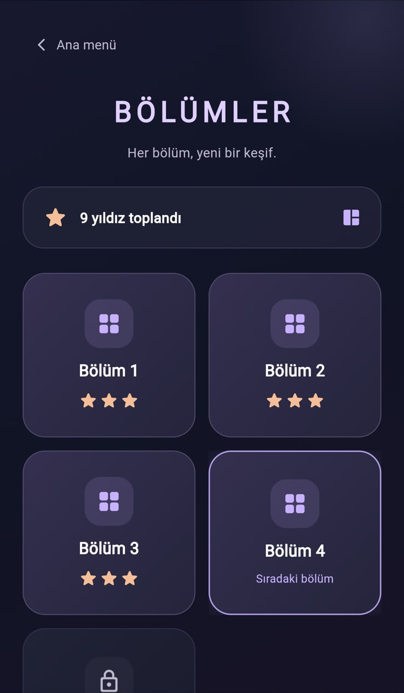
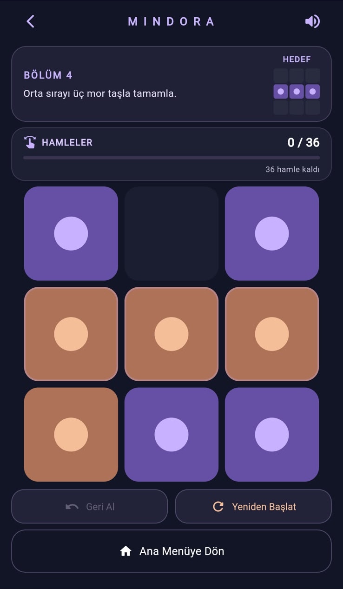

# Mindora – Mobile Puzzle Game

## About the Project

Mindora is an independently developed mobile puzzle game built with Flutter and Dart. The project combines logical thinking, puzzle-solving mechanics, and progressive challenges.

## Key Features

- 300 puzzle levels
- Custom puzzle mechanics
- Level progression system
- Mobile-friendly interface
- Automated puzzle solvability testing

## Technologies

- Flutter
- Dart
- Flutter Test
- Git

## Development & Testing

The project focuses on game logic, puzzle mechanics, level design, debugging, and software reliability.

Automated tests are used to evaluate puzzle solvability across 300 levels and identify potential issues in the puzzle engine.

## Screenshots

| Main Menu | Level Selection | Gameplay |
|:---:|:---:|:---:|
|  |  |  |

## Gameplay Demo

Coming soon.

## Project Status

Currently under development and testing.

## Developer

Eda Yaygılı – Software Engineer & Independent Game Developer

## Source Code

This repository serves as a public project showcase.
The game's source code is privately maintained.

© 2026 Eda Yaygılı. All rights reserved.
